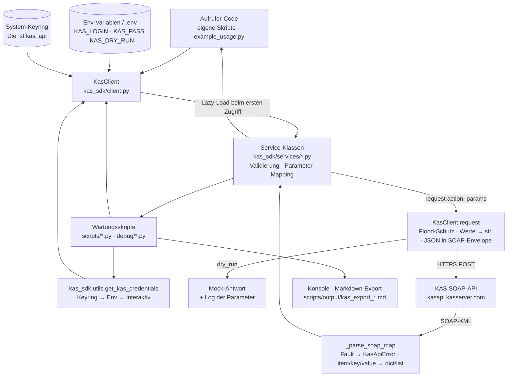

# Architektur-Übersicht – all-inkl-kas-sdk

Python-SDK für die SOAP-Schnittstelle des All-Inkl-Kundenadministrationssystems (KAS-API) plus eine Handvoll
Wartungsskripte, die das SDK nutzen. Das SDK ist eine Bibliothek ohne eigenen Server und ohne eigene Persistenz.

---

## Stack

| Schicht | Technologie |
|---------|-------------|
| Bibliothek (`kas_sdk/`) | Python ≥ 3.9 (laut `pyproject.toml`), `requests` (HTTP), `xml.etree.ElementTree` (Antwort-Parsing), `json` (Request-Payload) |
| Wartungsskripte (`scripts/`, `debug/`, `example_usage.py`) | Python, `argparse`, `tabulate`; Zugangsdaten über `kas_sdk.utils` (Keyring/Env/interaktiv) |
| Datenbank | keine |
| Auth | KAS-Login + Passwort je Request (`kas_auth_type="plain"`, alternativ `sha1`); Quelle: Argument, Env, System-Keyring — Details `docs/security/AUTHENTICATION.md` |
| Build | `setuptools` (`pyproject.toml`), Installation `pip install -e .`; CI: GitHub Actions, `pytest` auf Python 3.9 / 3.11 / 3.13 |

---

## Scope-Grenzen — Was dieses System NICHT tut

Bewusste Negativ-Liste. Sie verhindert Scope Creep und macht
Architekturentscheidungen nachvollziehbar.

- Kein eigener Dienst, keine Weboberfläche, kein Daemon — das SDK läuft im Prozess des Aufrufers.
- Keine eigene Persistenz und kein Cache: jeder Aufruf geht live an die KAS-API; Exporte schreibt nur das Skript
  `scripts/export_account.py` als Markdown-Datei.
- Kein Retry und kein Backoff: Fehler werden als Exception an den Aufrufer gegeben; nur eine feste Wartezeit
  zwischen zwei Requests (Flood-Schutz, Default 2 s).
- Keine Typisierung der Antworten: Rückgaben sind `dict`/`list`/`str` aus dem SOAP-Parser, keine Datenklassen.
- Keine Anbindung anderer Hoster-APIs; nur der offizielle Endpunkt `https://kasapi.kasserver.com/soap/KasApi.php`
  (per `api_url` überschreibbar).
- Keine Verwaltung von Zugangsdaten über das hinaus, was `keyring` und Umgebungsvariablen bieten (kein eigener
  Tresor, keine Rotation).
- Keine Zusicherung zur Vollständigkeit gegenüber der KAS-API: Maßstab ist `readme_KAS_API_SOURCE_OF_TRUTH.md`
  (generiert aus der lokal abgelegten Funktionsliste), Abdeckung siehe `docs/STATE.md` → Kennzahlen.

Änderungen an dieser Liste sind eine Architekturentscheidung → ADR erforderlich.

---

## Systemstruktur (Datenfluss)



---

## Modul-Verantwortlichkeiten

```
kas_sdk/client.py        → Transport: Credentials auflösen, SOAP-Envelope bauen, HTTPS-POST, Flood-Schutz, Dry-Run,
                           SOAP-Antwort in Python-Strukturen parsen, Services lazy laden
kas_sdk/exceptions.py    → Fehlerhierarchie KasApiError ⊃ KasAuthError, KasConnectionError
kas_sdk/services/base.py → Basisklasse: hält die Client-Referenz
kas_sdk/services/*.py    → je KAS-Paket ein Service (21 Stück): Parameter validieren (Enums, Bereiche),
                           auf KAS-Aktionsnamen abbilden, Antwort entpacken (ReturnInfo/ReturnString)
kas_sdk/utils.py         → Skript-Helfer: Zugangsdaten/Dry-Run-Präferenz aus Keyring/Env/Eingabe, Tabellenausgabe
scripts/*.py             → Wartungsaufgaben auf einem KAS-Account (Export, Wildcard-DNS, HSTS, SOT-Generator)
debug/*.py               → Einzelhost-Diagnose der SSL/HSTS-Felder
tests/*.py               → Offline-Tests mit gemocktem requests.post und XML-Fixtures
```

---

## Entscheidungsrelevante Constraints

| Constraint | Auswirkung |
|-----------|-----------|
| KAS-API erwartet alle Parameter als Strings („No Integers") | `KasClient.request` wandelt jeden Wert mit `str()` um und lässt `None` weg |
| `zone_host` braucht beim Anlegen einen Punkt am Ende, beim Ändern darf er fehlen | `DnsService.add_dns_settings` ergänzt den Punkt; `update_dns_settings` sendet keinen `zone_host` |
| KAS-Flood-Schutz zwischen zwei Requests | feste Wartezeit `flood_protection_delay` (Default 2,0 s) im Client; Skripte mit vielen Hosts laufen entsprechend lange |
| Zugangsdaten werden bei jedem Request mitgeschickt (`kas_auth_data`) | Passwort liegt im Prozessspeicher und in jedem Request-Body; jedes Log des Bodys ist ein Secret-Leck (`docs/security/THREAT_MODEL.md` Bedrohung 1) |
| SOAP-Antworten sind generische `item/key/value`-Maps | Parser rät per Heuristik Liste vs. Dict (Schlüssel `0..N`); Rückgabetypen sind nicht statisch typisiert |
| Öffentliches Repository, MIT-Lizenz | keine Interna in Code/Doku/Commits (`docs/CONVENTIONS_COMMON.md` 3.1); lokale Umgebungsdetails nur in `docs/local/` |
| Python-Mindestversion 3.9 (End of Life seit 2025-10-31) | Anhebung ist offen (`docs/TODO.md`), CI-Matrix 3.9/3.11/3.13 |

---

## Lese-Pfad für Architektur-Details

Wenn du tiefer einsteigen willst, lies in dieser Reihenfolge — jeder Schritt
baut auf dem vorigen auf:

1. **Diese Datei** (`OVERVIEW.md`) — Big Picture, Scope-Grenzen, Datenfluss.
2. `architecture/PROJECT_LAYOUT.md` — wo welche Schicht und welcher Code liegt.
3. `architecture/CONFIGURATION.md` — wie die Anwendung konfiguriert wird.
4. `architecture/ERROR_HANDLING.md` — wie Fehler propagiert und behandelt werden.
5. `architecture/ADR/` — historische Architekturentscheidungen (bisher nur die Vorlage `ADR-000-template.md`).
6. **Stack-spezifische Architektur-Docs:** `docs/architecture/CLI.md` (Aufrufschnittstelle der Wartungsskripte) und
   `docs/architecture/DEPENDENCIES.md` (Bibliotheken und externe Dienste).
7. **API-Referenz (Bestandsdoku, englisch, unverändert übernommen)** — Nutzung der Services mit Beispielen und
   Antwortfeldern. Bekannte Abweichungen zum Code stehen in `docs/KNOWN_ISSUES.md` (K8):
   - `docs/01_account.md` — AccountService, SessionService
   - `docs/02_domains_dns.md` — DomainService, SubdomainService, DnsService, DdnsService, SslService
   - `docs/03_email.md` — MailAccount-, MailForward-, MailFilter-, MailingList-, DkimService
   - `docs/04_system.md` — Cronjob-, Database-, FtpUser-, SoftwareInstall-, Statistic-, DirectoryProtection-,
     SambaUser-, Chown-, SymlinkService
8. **API-Maßstab:** `readme_KAS_API_SOURCE_OF_TRUTH.md` im Repo-Root (Pflicht-/optionale Parameter und
   Fehlercodes je KAS-Aktion, erzeugt von `scripts/generate_source_of_truth.py`) und `README.md` (Nutzer-Einstieg).

Begriffe und Geschäftssprache: `docs/GLOSSARY.md`.
Bekannte Einschränkungen und Probleme: `docs/KNOWN_ISSUES.md`.
