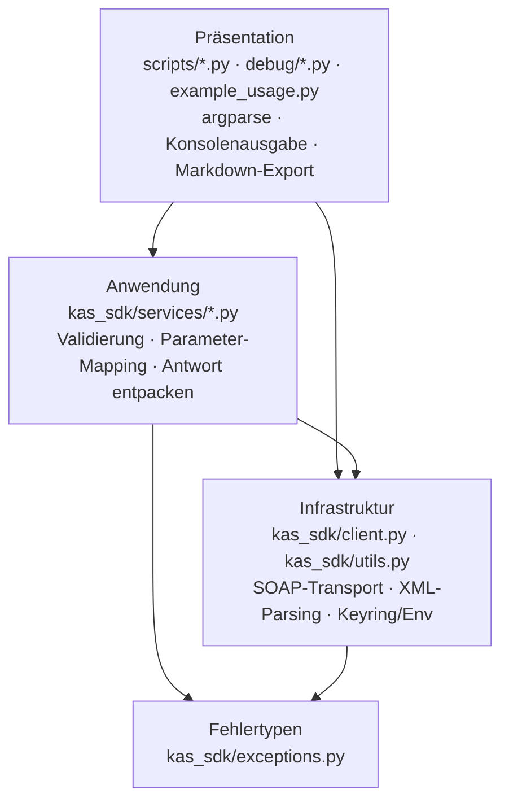

# Projekt-Layout – all-inkl-kas-sdk

Tatsächliche Ordnerstruktur und Schichten-Modell. Der Stack `python-cli` liefert kein eigenes Layout-Dokument;
diese Datei beschreibt den Ist-Zustand (flaches Paket-Layout, kein `src/`) und die Regeln für neue Module.

Verbindet sich mit den Prinzipien [[SEPARATION_OF_CONCERNS]] und [[ORTHOGONALITY]].

---

## Schichten-Modell



**Regeln für Abhängigkeiten:**

- Pfeile zeigen erlaubte Aufrufrichtung (nur nach unten / nach innen).
- Eine eigene Domänenschicht gibt es nicht: Das SDK reicht die KAS-Datenstrukturen als `dict`/`list` durch.
  Fachregeln der KAS-API (Enum-Werte, Pflichtparameter, String-Zwang) liegen in den Services.
- Services rufen ausschließlich `self.client.request(action, params)` auf; sie kennen weder `requests` noch XML.
- Präsentation darf `KasClient` direkt erzeugen (Composition Root jedes Skripts) und `kas_sdk.utils` für
  Zugangsdaten nutzen; Fachlogik der API gehört nicht in die Skripte, sondern in einen Service.
- `kas_sdk/utils.py` ist Skript-Infrastruktur (Keyring, `input()`, `print`, `tabulate`) und wird vom
  Bibliothekskern (`client.py`, `services/`) **nicht** importiert.

---

## Tatsächliches Skelett

```
all-inkl-kas-sdk/
├── kas_sdk/                     # Bibliothek (installierbar: pip install -e .)
│   ├── __init__.py              # Öffentliche API: KasClient + Exceptions
│   ├── client.py                # Transport, Parsing, Lazy-Loading der Services
│   ├── exceptions.py            # KasApiError, KasAuthError, KasConnectionError
│   ├── utils.py                 # Skript-Helfer (Credentials, Dry-Run-Präferenz, Tabellen)
│   └── services/                # Ein Modul je KAS-Paket (21) + base.py
├── scripts/                     # Wartungsskripte (Präsentation), Ausgabe nach scripts/output/ (gitignored)
├── debug/                       # Diagnose-Skripte für einzelne Hosts
├── tests/                       # Offline-Tests (pytest/unittest), keine Unterordner
├── tools/git-hooks/             # Interna-Hook (pre-commit, commit-msg)
├── docs/                        # Dieses Doku-Set + API-Referenz 01–04 (Bestand)
├── example_usage.py             # Interaktives Beispiel
├── readme_KAS_API_SOURCE_OF_TRUTH.md  # Generierter API-Maßstab
├── pyproject.toml / requirements.txt
└── .github/workflows/ci.yml     # pytest-Matrix
```

> Abweichung vom Template-Skelett: kein `src/`-Layout und keine Trennung `tests/unit` / `tests/integration`.
> `tests/test_integration.py` enthält trotz des Namens Offline-Tests gegen XML-Fixtures (kein Netz) — siehe
> `docs/testing/INTEGRATION_TESTS.md`. Eine Umstellung ist nicht geplant (kein belegter Bedarf).

---

## Regeln

- **Ein Modul pro KAS-Paket** unter `kas_sdk/services/`, Klassenname `<Paket>Service`, Registrierung in
  `KasClient._SERVICE_MAP` (Attributname = Modulname) **und** in `kas_sdk/services/__init__.py`.
- **Imports gehen nur nach unten** entlang des Schichten-Graphen — keine zyklischen
  Abhängigkeiten zwischen Schichten.
- **Kein HTTP/XML in Services**, keine KAS-Fachlogik in `client.py` außer den API-weiten Regeln
  (String-Zwang, Fault-Erkennung, Response-Unwrapping).
- **Tests parallel zur Quellstruktur**: neue Service-Logik bekommt Tests in `tests/` (gemocktes `requests.post`).
- **Build-Output und Caches** gehören in `.gitignore` (`scripts/output/` via `output/`, `__pycache__/`,
  `.pytest_cache/`, `*.egg-info/`).

---

## Schichtregel als ausführbarer Check

Noch nicht eingerichtet. Die Regeln oben werden bisher nur im Review geprüft. Kandidat: `import-linter` mit einem
Contract „`kas_sdk.client`, `kas_sdk.services` importieren nicht `kas_sdk.utils`" — als Backlog-Punkt geführt
(`docs/BACKLOG.md` → Refactoring-Kandidaten), weil der Schaden einer Verletzung heute klein ist (ein Paket, drei
Schichten).

---

## Anti-Pattern

- **API-Logik im Skript:** Skripte wie `scripts/ssl_enforce_hsts.py` interpretieren KAS-Felder selbst
  (`ssl_certificate_sni_is_active` = `j`/`Y`). Wiederverwendbare Interpretation gehört in den Service.
- **„Utils"-Ordner als Sammelbecken:** `kas_sdk/utils.py` mischt Credential-Beschaffung und Tabellenausgabe;
  neue Helfer nicht dort ablegen, sondern nach Verantwortung benennen.
- **Antworten im Skript neu parsen:** Strukturkonvertierung gehört in `KasClient._parse_element`.

---

## Pflege

Trigger (siehe `KICKOFF.md` Phase 3a): neue Schicht / Modul-Verschiebung
zwischen Schichten / neue stack-spezifische Layout-Variante → diese Datei
aktualisieren.
